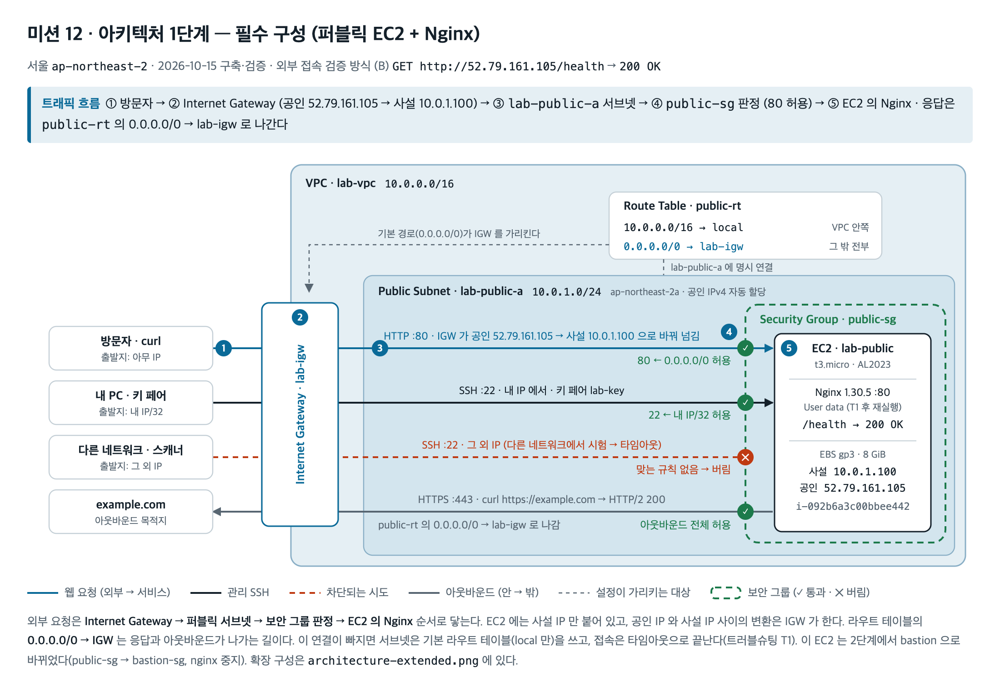
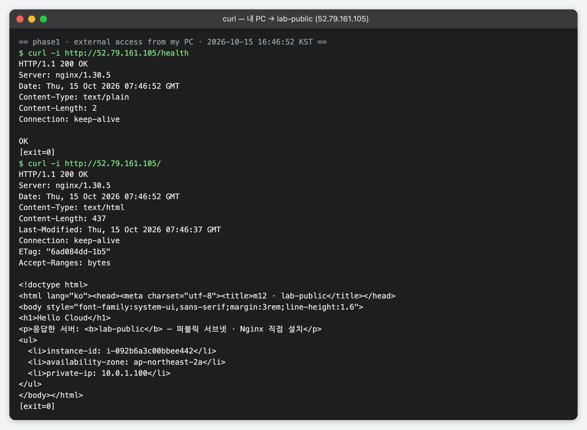
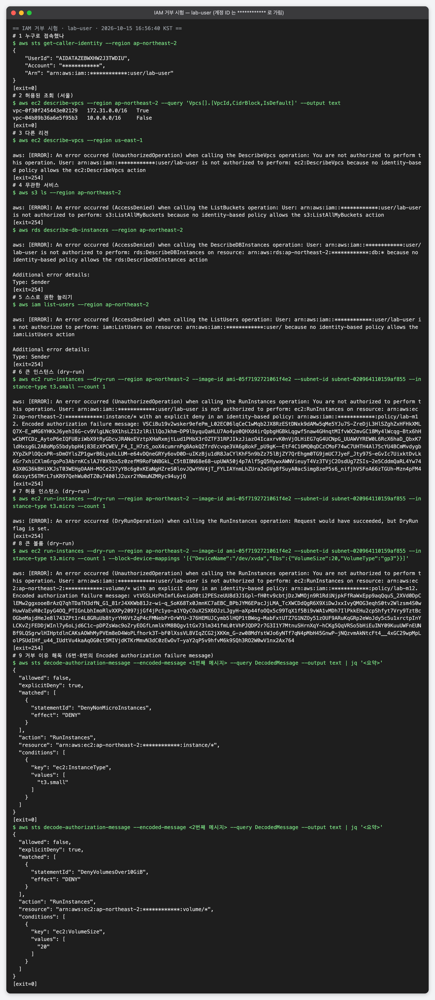
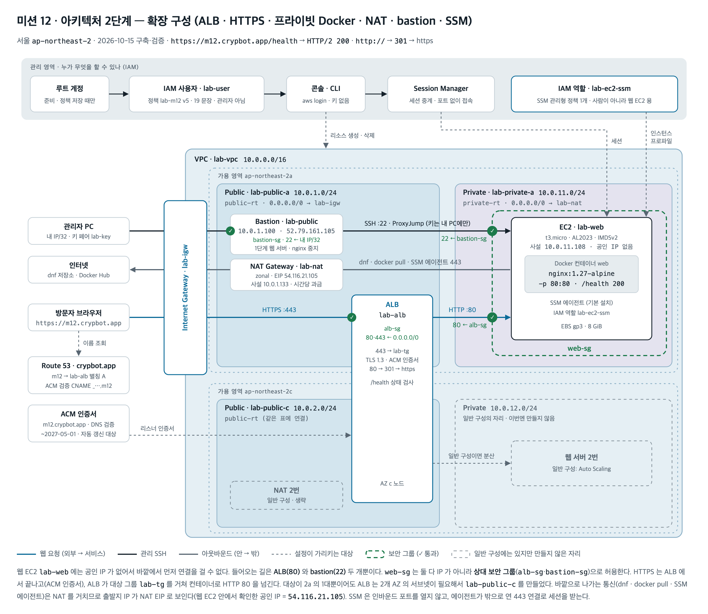
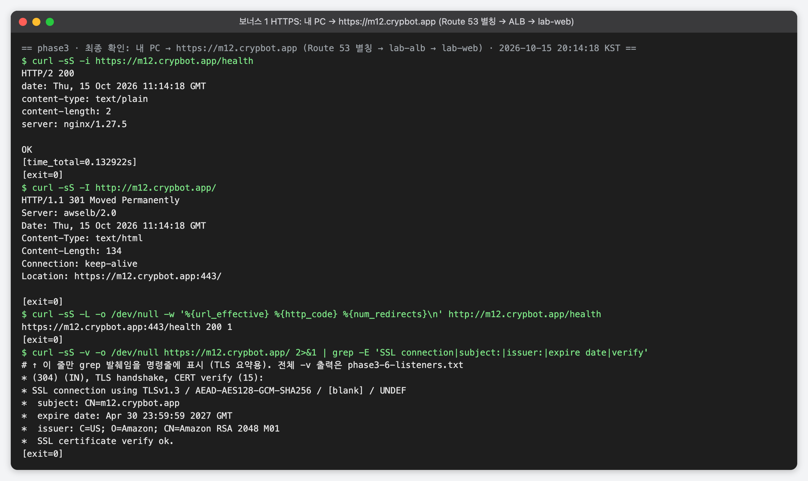
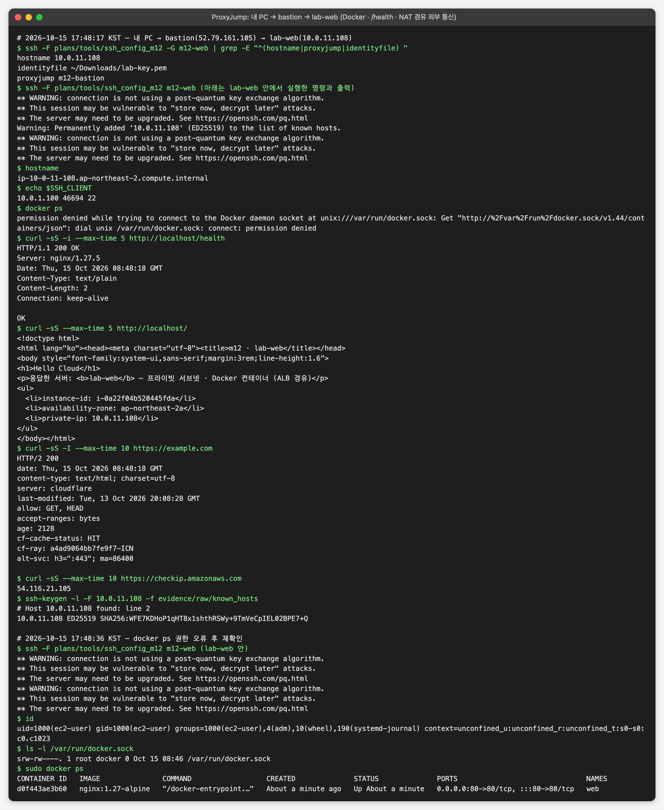
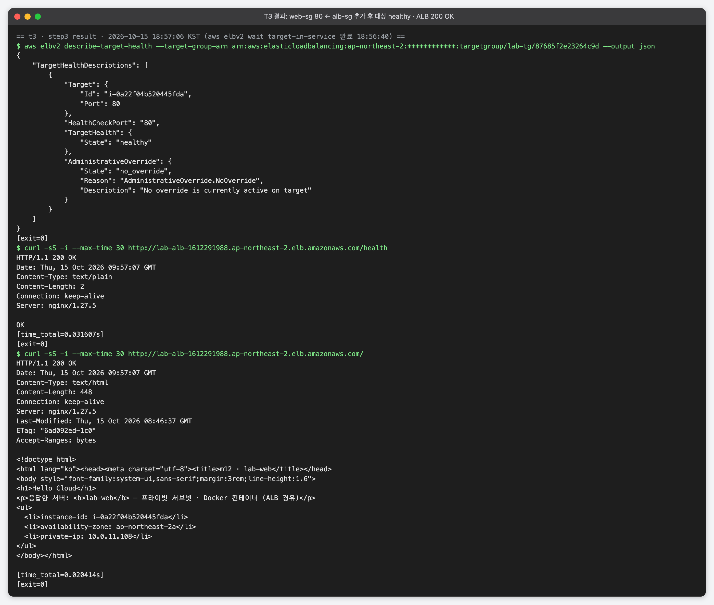

# 12 - 내가 만든 웹사이트를 인터넷에 올려 누구나 쓰게 하기 (AWS Web Deploy)

> ✅ **구축·검증 완료 (2026-10-15)** · 리소스는 평가가 끝날 때까지 유지하고, 그 뒤 [`docs/cleanup-checklist.md`](docs/cleanup-checklist.md) 순서대로 정리한다(현재 **정리 전**)

VPC 로 격리된 네트워크를 직접 만들고, EC2 에 Nginx 를 올려 **외부에서 접속 가능한** 웹 서비스를 완성했다.
과제가 요구하는 구성(퍼블릭 EC2 1대)을 먼저 만들어 증빙을 남겼다. 그다음 같은 VPC 를 운영형 구성으로 넓혔다.
웹 서버를 프라이빗 서브넷의 Docker 컨테이너로 옮기고, 앞에 ALB 와 HTTPS 를 붙였다.

**이 미션의 결과물은 코드가 아니라 문서 4종이다.** 레포의 스크립트·정책 파일은 콘솔에 붙여 넣은 원본이다.

- 과제 원문: 로컬 `../12-aws-web-deploy.md`

## 제출물

| # | 제출물 | 위치 |
|---|---|---|
| 1 | 아키텍처 다이어그램 | [`docs/architecture.png`](docs/architecture.png) (필수 구성) · [`docs/architecture-extended.png`](docs/architecture-extended.png) (확장 구성) |
| 2 | 웹 서비스 외부 접속 증빙 | 아래 [외부 접속 검증](#외부-접속-검증--방식-b) · [`screenshots/phase1-curl-health.png`](screenshots/phase1-curl-health.png) |
| 3 | 트러블슈팅 보고서 | [`docs/troubleshooting.md`](docs/troubleshooting.md) — 2건 (T1 라우팅 · T-ALB 권한) |
| 4 | 리소스 정리 체크리스트 | [`docs/cleanup-checklist.md`](docs/cleanup-checklist.md) |



*▲ 트래픽 흐름: ① 방문자 → ② Internet Gateway(공인 52.79.161.105 → 사설 10.0.1.100) → ③ `lab-public-a` 서브넷 → ④ `public-sg` 판정(80 허용) → ⑤ EC2 의 Nginx. 응답은 `public-rt` 의 `0.0.0.0/0 → lab-igw` 로 나간다.*

## 외부 접속 검증 — 방식 (B)

| 항목 | 값 |
|---|---|
| 선택한 방식 | **(B) `GET http://<퍼블릭IP>/health` 호출** |
| 접속 정보 | **`http://52.79.161.105/health`** (EC2 `lab-public` 의 공인 IPv4) |
| 결과 | `HTTP/1.1 200 OK` · 본문 `OK` (2026-10-15 16:46:52 KST, 내 PC 에서) |
| 증빙 | [`phase1-curl-health.png`](screenshots/phase1-curl-health.png) (curl) · [`phase1-browser-root.png`](screenshots/phase1-browser-root.png) (같은 IP 의 `/` 를 브라우저로) |

```
$ curl -i http://52.79.161.105/health
HTTP/1.1 200 OK
Server: nginx/1.30.5
Date: Thu, 15 Oct 2026 07:46:52 GMT
Content-Type: text/plain
Content-Length: 2
Connection: keep-alive

OK
```



*▲ 필수 증빙 — 내 PC 에서 `curl -i http://52.79.161.105/health` → `200 OK` · `OK`*

- 이 주소는 **1단계(필수 구성) 시점**의 결과다. 2단계에서 이 EC2 를 bastion 으로 바꾸면서 80 을 닫았다(보안 그룹 교체 + nginx 중지).
  그래서 지금 이 주소로 들어가면 타임아웃이 난다. 이후 웹 서비스 주소는 `https://m12.crypbot.app` 이다([확장 구성](#확장-구성-2단계)).
- 리소스를 정리하면 두 주소 모두 동작하지 않는다. 위 캡처가 증빙이다.

**방식 (B) 를 고른 이유** — 상태 코드(`200 OK`)와 고정 본문(`OK`)이 글자로 남는다. 그래서 명령 · 시각 · 응답을 캡처 한 장에 담을 수 있다.
같은 `/health` 경로를 2단계에서는 ALB 의 상태 검사 경로로 그대로 썼다. (A) 브라우저 화면은 주소창이 캡처에 찍히지 않아 어느 주소로 접속했는지 보이지 않는다.
그래서 같은 IP 의 브라우저 캡처([`phase1-browser-root.png`](screenshots/phase1-browser-root.png))는 보조 증빙으로만 남겼다.

**접속 경로 — 1단계와 2단계의 차이**

| | 1단계 (필수) | 2단계 (확장) |
|---|---|---|
| 주소 | `http://52.79.161.105` — EC2 의 공인 IP | `https://m12.crypbot.app` — Route 53 별칭 A → ALB |
| 경로 | 내 PC → IGW → `lab-public` 의 Nginx (인스턴스가 직접 응답) | 내 PC → IGW → ALB 노드(공인 IP 2개) → `lab-web` 사설 IP:80 → 컨테이너 |
| 응답 헤더 `Server` | `nginx/1.30.5` | `/health` 는 `nginx/1.27.5`(컨테이너), `http://` 리다이렉트는 `awselb/2.0`(ALB) |
| 주소가 바뀌는 경우 | 인스턴스를 새로 만들면 공인 IP 가 바뀐다 | ALB 노드 IP 는 바뀔 수 있지만, 도메인이 ALB 를 가리키므로 주소는 그대로다 |

## 구성 (1단계 · 필수)

| 항목 | 값 |
|---|---|
| 리전 | 서울 `ap-northeast-2` |
| VPC | `lab-vpc` `10.0.0.0/16` |
| Public Subnet | `lab-public-a` `10.0.1.0/24` (ap-northeast-2a, 공인 IPv4 자동 할당) |
| Internet Gateway | `lab-igw` — `lab-vpc` 에 연결 |
| Route Table | `public-rt` — `10.0.0.0/16 → local`, **`0.0.0.0/0 → lab-igw`**, `lab-public-a` 명시 연결 |
| Security Group | `public-sg` — 80 ← `0.0.0.0/0`, 22 ← 내 IP `/32` |
| 인스턴스 | `lab-public` `t3.micro` (사설 10.0.1.100 / 공인 52.79.161.105) |
| OS | Amazon Linux 2023 |
| EBS | gp3 8 GiB |
| 웹 서버 | Nginx 1.30.5 — User data 스크립트([`scripts/user-data-public.sh`](scripts/user-data-public.sh))로 설치(첫 부팅 때는 실패 → [T1](docs/troubleshooting.md#t1--공인-ip-로-접속하면-타임아웃) 수정 후 재실행), `/health` → `200 OK` |
| 키 페어 | `lab-key` (ED25519) — `.pem` 은 레포 밖 로컬 폴더에 두고 권한 `400`(소유자 읽기만). 레포는 `.gitignore` 로 `*.pem` · `*.key` 를 막는다. 2단계에서도 bastion 에 복사하지 않았다(ProxyJump) |

**라우팅 연결 요약** — `lab-public-a` → `public-rt`(명시 연결) → `0.0.0.0/0` → `lab-igw`.
2단계에서는 `lab-public-c` 도 `public-rt` 에, `lab-private-a` 는 `private-rt`(`0.0.0.0/0` → `lab-nat`)에 연결했다.
기본 라우트 테이블(`local` 만)에 남은 서브넷은 없다([`phase3-1-public-rt-associations.png`](screenshots/phase3-1-public-rt-associations.png) · [`phase2-4-route-tables.png`](screenshots/phase2-4-route-tables.png)).

**아웃바운드가 필요한 이유** — 첫 부팅 때 User data 가 `dnf install -y nginx` 로 패키지 저장소(S3, HTTPS)에서 Nginx 를 받는다.
`0.0.0.0/0 → lab-igw` 가 없던 [T1](docs/troubleshooting.md#t1--공인-ip-로-접속하면-타임아웃) 에서는 이 설치가 타임아웃으로 실패했다.

웹 페이지(`/`)에는 응답한 인스턴스의 ID · AZ · 사설 IP 가 찍힌다. 캡처만 봐도 어느 서버가 응답했는지 알 수 있게 했다.

## 요건 대조표

| 요건 (과제 §4) | 충족 근거 |
|---|---|
| VPC 1개 | `lab-vpc` 10.0.0.0/16 — [`phase3-1-public-rt-associations.png`](screenshots/phase3-1-public-rt-associations.png)(VPC 이름) · [`phase2-4-route-tables.png`](screenshots/phase2-4-route-tables.png)(`10.0.0.0/16 → local`) |
| Public Subnet 1개 | `lab-public-a` 10.0.1.0/24 — [`phase3-1-public-rt-associations.png`](screenshots/phase3-1-public-rt-associations.png)(`public-rt` 명시 연결 · CIDR) |
| IGW 를 VPC 에 연결 | `lab-igw` 연결됨(Attached) — [`t1-3-check2-igw.png`](screenshots/t1-3-check2-igw.png) |
| Public Subnet 라우트 테이블에 `0.0.0.0/0 → IGW` | `public-rt` — [`t1-8-resource-map-after.png`](screenshots/t1-8-resource-map-after.png) · [`phase2-4-route-tables.png`](screenshots/phase2-4-route-tables.png) |
| 인스턴스의 아웃바운드 통신 (`curl https://example.com`) | 인스턴스 안에서 `HTTP/2 200` — [`phase1-inside-localhost-outbound.png`](screenshots/phase1-inside-localhost-outbound.png) |
| Public Subnet 에 EC2 1대 | `lab-public` — [`t1-2-check1-instance.png`](screenshots/t1-2-check1-instance.png)(실행 중 · t3.micro · 2a · 공인 IP) · [`phase1-inside-localhost-outbound.png`](screenshots/phase1-inside-localhost-outbound.png)(사설 `10.0.1.100/24` = `lab-public-a` 대역) |
| SSH 접속 | 내 PC → `ssh ec2-user@52.79.161.105` 성공 — [`phase1-other-network-ssh.png`](screenshots/phase1-other-network-ssh.png)(뒷부분) |
| 웹 서버 설치·실행 | nginx `active` · `enabled` — [`phase1-inside-localhost-outbound.png`](screenshots/phase1-inside-localhost-outbound.png) |
| 인스턴스에서 `curl http://localhost` → 200 | `/health`·`/` 둘 다 `200 OK` — 같은 캡처 |
| SG 인바운드는 필요한 포트만 | `public-sg` 인바운드 규칙 2개뿐(80·22) — [`t1-4-check3-sg.png`](screenshots/t1-4-check3-sg.png) |
| HTTP(80) ← `0.0.0.0/0` | 같은 캡처 |
| SSH(22) ← 개인 IP 만 | 22 ← 내 IP `/32`. 다른 네트워크에서는 22 타임아웃, 80 은 성공 — [`phase1-other-network-ssh.png`](screenshots/phase1-other-network-ssh.png) |
| `0.0.0.0/0` 전체 포트 허용 규칙 없음 | 같은 SG 캡처 (전체 포트 규칙 없음) |
| IAM 사용자 1개, EC2/VPC/SG 범위로 제한, S3/RDS 권한 없음, 관리자 권한 없음 | `lab-user` + 고객 관리형 정책 `lab-m12`. 필수 범위(EC2 · VPC · SG)에 확장 구성용 ELB · ACM · Route 53 · SSM action 만 더했고, 서울 리전으로 고정했다. S3 · RDS 권한과 관리자 권한은 없다 — [IAM 최소권한](#iam-최소권한) · [`phase1-iam-deny.png`](screenshots/phase1-iam-deny.png) |
| 외부 접속 검증(택 1) + README 에 명시 | 방식 (B) — [위](#외부-접속-검증--방식-b) |
| 실습 종료 후 정리 · 근거 | [`docs/cleanup-checklist.md`](docs/cleanup-checklist.md) — **정리 전**(평가 후 정리하고 확인 칸에 근거 기입) |

## 보안 그룹

| 보안 그룹 | 붙은 곳 | 인바운드 | 왜 |
|---|---|---|---|
| `public-sg` | 1단계 `lab-public` | 80 ← `0.0.0.0/0` · 22 ← 내 IP `/32` | 웹은 누구나, 관리 포트는 나만. 22 를 전체에 열면 바로 스캔·비밀번호 대입 대상이 된다 |
| `bastion-sg` | 2단계 `lab-public`(bastion) | 22 ← 내 IP `/32` | 웹 역할을 내려놓았으므로 80 을 없앴다 |
| `alb-sg` | `lab-alb` | 80 · 443 ← `0.0.0.0/0` | 웹 트래픽의 입구는 ALB 하나. 80 은 443 으로 리다이렉트만 한다 |
| `web-sg` | `lab-web` | 22 ← **`bastion-sg`** · 80 ← **`alb-sg`** | 출처를 IP 대역이 아니라 **보안 그룹**으로 지정했다. ALB 노드 IP 는 바뀌고, 서브넷 대역(`10.0.1.0/24`)으로 열면 같은 서브넷의 NAT 까지 허용된다 |

- 아웃바운드는 모두 기본값(전체 허용)이다.
- **22 출처 IP** — 접속한 장소(교육장)의 공인 IP 하나를 `/32` 로 넣었다(`checkip.amazonaws.com` 으로 확인). 장소가 바뀌어 IP 가 달라지면 22 는 타임아웃이 난다([다른 네트워크 시험](screenshots/phase1-other-network-ssh.png)).
  그때는 규칙을 새 `/32` 로 바꾸거나, 인바운드 포트 없이 접속하는 Session Manager 를 쓴다(2단계 `lab-web`).
- **변경 이력** — `public-sg` 는 2단계에서 `lab-public` 에서 떼어 냈다(연결 없이 남겨 두고 정리 때 삭제). `web-sg` 는 만들 때 22 ← bastion-sg 하나였고, 3단계에서 80 ← alb-sg 를 더했다.
- 그래서 `web-sg` 의 설명 문구는 `m12 web - SSH from bastion-sg only` 로 남아 지금은 사실과 다르다. 보안 그룹 설명은 생성 후 바꿀 수 없으므로 실제 규칙은 위 표를 기준으로 본다.

## IAM 최소권한

**Security Group 과 IAM 은 지키는 대상이 다르다.** 보안 그룹은 **네트워크 패킷**을 거른다. 누가 어느 포트로 인스턴스에 들어올 수 있는지를 정한다.
IAM 은 **AWS API 호출**을 거른다. 누가 어떤 AWS 작업(인스턴스 생성, SG 수정 등)을 할 수 있는지를 정한다.
SG 를 잘 막아도 IAM 이 넓으면 누군가 SG 자체를 열 수 있다. 그래서 둘 다 최소로 둔다.

**변경 흐름** — SG 규칙은 `lab-user` 가 콘솔에서 바꾼다(정책이 허용하는 범위). IAM 정책은 `lab-user` 가 바꿀 수 없다.
작업이 거부되면 거부 메시지로 필요한 action 을 확인하고, 루트가 그 action 하나만 더한 새 버전을 저장한다. 그다음 [기능으로 반영을 확인](#권한을-바꾼-뒤의-확인)한다.

### 실습 계정 구성

| 주체 | 권한 | 용도 |
|---|---|---|
| 루트 계정 | 전체 (패스키 MFA) | 준비 단계(정책·역할·사용자 생성, 호스팅 영역 확인)와 정책 버전 저장에만 사용. VPC · EC2 등 실습 리소스 작업에는 쓰지 않음 |
| IAM 사용자 `lab-user` | 고객 관리형 정책 [`lab-m12`](iam/lab-m12-policy.json) **v5** (19 문장) | 모든 실습 작업 (콘솔 · CLI) |
| IAM 역할 `lab-ec2-ssm` | AWS 관리형 `AmazonSSMManagedInstanceCore` 하나, 신뢰 대상 EC2 ([`trust`](iam/lab-ec2-ssm-trust.json)) | 사람이 아니라 `lab-web` 인스턴스가 쓰는 권한 (Session Manager 접속) |

CLI 는 Access Key 를 만들지 않고 **`aws login`** 으로 썼다. 임시 자격증명이 15분마다 갱신되고 최대 12시간 유효하다.
오래 사는 키가 PC 에 남지 않는다.

### `lab-m12` 정책의 설계

[`iam/lab-m12-policy.json`](iam/lab-m12-policy.json) 의 `ACCOUNT_ID` · `HOSTED_ZONE_ID` · `DOMAIN` 은 자리표시자다. 콘솔에 붙일 때 실제 값으로 바꿨다.

| 원칙 | 정책에서 하는 일 (Sid) |
|---|---|
| 필요한 서비스만 | EC2 · VPC · ELB · ACM · SSM · Route 53 만 허용. **S3 · RDS 권한은 없다.** IAM 은 세 가지만 된다 — `lab-ec2-ssm` 을 EC2 에 넘기기(`PassRole`), ELB 서비스 연결 역할 만들기, 인스턴스 프로파일 목록 보기. 사용자 · 정책 · 역할은 바꿀 수 없다 |
| 서울 리전만 | 생성·조회 문장에 `aws:RequestedRegion = ap-northeast-2` 조건 (`ReadOnlyInSeoul` · `BuildNetwork` · `RunInstances` · `BuildLoadBalancer` · `ManageCertificate`) |
| 비싼 리소스 차단 | `t3.micro` 가 아닌 인스턴스 생성 **명시적 거부**(`DenyNonMicroInstances`), 10 GiB 초과 볼륨 **명시적 거부**(`DenyVolumesOver10GiB`) |
| DNS 는 실습 이름만 | Route 53 변경은 `m12.<도메인>` 과 `_*.m12.<도메인>`(ACM 검증)의 A · CNAME 만. 도메인 루트·MX·TXT·NS 는 못 건드린다 (`ChangeOnlyLabSubdomainAliasAndAcmValidation`) |
| 역할 넘기기 제한 | `iam:PassRole` 은 `lab-ec2-ssm` 을 EC2 에 넘길 때만 (`PassOnlyLabRoleToEc2`). 다른 역할로 권한을 키울 수 없다 |
| 접속은 실습 인스턴스만 | SSM 세션 시작은 태그 `Project=m12` 인 인스턴스만 (`StartSessionOnLabInstancesOnly`). 세션 입출력·종료는 자기 세션만 (`OwnSessionsOnly` · `EndOwnSessionsIamUser`) |
| 거부 이유 확인 | `sts:DecodeAuthorizationMessage` 허용 — 명시적 거부가 어느 문장 때문인지 직접 해독 (`DecodeAuthorizationErrors`) |

**버전 이력** — 실제 작업이 거부됐을 때만 그 action 하나를 더했다.

| 버전 | 바뀐 것 | 이유 |
|---|---|---|
| v1 | 최초 17 문장 | |
| v2 | `CliLoginSameDeviceOnly` 추가 | Access Key 대신 `aws login` 사용 |
| v3 | `EndOwnSessionsIamUser` 분리 | SSM 세션 종료가 거부됨. IAM 사용자는 `${aws:userid}` 가 이름이 아니라 고유 ID 라 패턴이 안 맞았다 → `${aws:username}` |
| v4 | Route 53 허용 이름을 `m12` 서브도메인으로 좁힘 | 도메인 루트는 다른 용도로 비워 둠 |
| v5 | `elasticloadbalancing:AddListenerCertificates` 추가 | 콘솔의 HTTPS 리스너 추가가 거부 후 롤백 → [트러블슈팅 T-ALB](docs/troubleshooting.md#t-alb--https-리스너-추가가-accessdenied-후-롤백) |

콘솔 화면 곳곳에 "액세스 거부됨" 배너가 떴다. 예: SSM 연결 화면의 `ssm:GetServiceSetting`, Route 53 대시보드의 `route53domains:*`.
이 배너들은 **화면 표시용 조회**라 실제 작업을 막지 않아서 권한을 더하지 않았다
([`phase2-6-ssm-connect-precheck-denied.png`](screenshots/phase2-6-ssm-connect-precheck-denied.png) · [`phase3-5-route53-dashboard-denied.png`](screenshots/phase3-5-route53-dashboard-denied.png)).
SSO(역할)로 바꾸면 `EndOwnSessionsIamUser` 는 다시 손봐야 한다. 역할 세션에는 `aws:username` 이 없다.

### 거부 시험 — 정책이 실제로 막는지 ([`phase1-iam-deny.png`](screenshots/phase1-iam-deny.png))

| # | 시도 | 결과 |
|---|---|---|
| 1 | `sts get-caller-identity` | `lab-user` 로 접속됨 |
| 2 | 서울 `ec2 describe-vpcs` | 허용 |
| 3 | 다른 리전(`us-east-1`) `ec2 describe-vpcs` | 거부 — 허용 문장 없음(암묵적 거부) |
| 4 | `s3 ls` · `rds describe-db-instances` | 거부 — 암묵적 거부 |
| 5 | `iam list-users` | 거부 — 암묵적 거부 |
| 6 | `run-instances --dry-run` `t3.small` | 거부 — **명시적 거부** |
| 7 | `run-instances --dry-run` `t3.micro` | `DryRunOperation` — 권한 있음(실제로 만들지는 않음) |
| 8 | `run-instances --dry-run` `t3.micro` + 20 GiB 볼륨 | 거부 — **명시적 거부** |
| 9 | 6·8 의 거부 메시지 해독 | `DenyNonMicroInstances` · `DenyVolumesOver10GiB` 가 거부했음을 확인 |



*▲ `lab-user` 로 실행한 거부 시험 9종 (계정 ID 만 가림)*

### 권한을 바꾼 뒤의 확인

`lab-user` 는 IAM 정책을 읽을 수 없다. 그래서 정책 반영은 **실패해야 할 것과 성공해야 할 것을 짝으로 실행**해 기능으로 확인했다.

| 확인 대상 | 실패 쪽 | 정상 쪽 |
|---|---|---|
| 인스턴스 타입 · 볼륨 제한 | `run-instances --dry-run` `t3.small` → 명시적 거부 | 같은 명령 `t3.micro` → `DryRunOperation` (`--dry-run` 이라 리소스는 만들지 않는다) |
| v3 (SSM 세션 종료) | 수정 전 `terminate-session` → `AccessDenied` | 수정 후 **같은 명령 · 같은 세션** → 성공, 세션 `Terminated` |
| v4 (Route 53 이름 제한) | — | ACM 검증 CNAME 과 `m12` 별칭 A 레코드 생성 성공 |
| v5 (`AddListenerCertificates`) | 반영 전이라면 `AccessDenied` 로 판단 | 없는 리스너 ARN 에 호출 → `ListenerNotFound` (권한 통과, 리소스 변경 없음) → [T-ALB](docs/troubleshooting.md#t-alb--https-리스너-추가가-accessdenied-후-롤백) |
## 확장 구성 (2단계)



| 구성 요소 | 값 |
|---|---|
| 서브넷 | `lab-public-a` 10.0.1.0/24 · `lab-public-c` 10.0.2.0/24 (ALB 용) · `lab-private-a` 10.0.11.0/24 |
| 라우트 테이블 | `public-rt` (0.0.0.0/0 → IGW, a·c 연결) · `private-rt` (0.0.0.0/0 → NAT) |
| NAT Gateway | `lab-nat` zonal, `lab-public-a`, EIP `lab-nat-eip` 54.116.21.105 |
| Bastion | 1단계 `lab-public` 을 그대로 전환 — SG `public-sg` → `bastion-sg`, nginx 중지·비활성 |
| 웹 EC2 | `lab-web` `t3.micro` AL2023, 사설 10.0.11.108, **공인 IP 없음**, IMDSv2, 역할 `lab-ec2-ssm` |
| ALB | `lab-alb` internet-facing, 2a · 2c, 대상 그룹 `lab-tg`(HTTP:80, `/health`) |
| HTTPS | ACM 인증서 `m12.crypbot.app` + Route 53 별칭 A 레코드 |
| 관리 접속 | SSH ProxyJump (내 PC → bastion → lab-web, 키는 bastion 에 복사하지 않음) · Session Manager (인바운드 포트 없음) |

**설계 근거**

- **웹 서버를 프라이빗에** — 공인 IP 가 없어 바깥에서 먼저 연결을 걸 수 없다. 들어오는 길은 ALB(80)와 bastion(22) 두 개뿐이다.
- **NAT 는 zonal** — 콘솔에 새로 생긴 "리전별(Regional)" 모드는 퍼블릭 서브넷 없이 AZ 를 자동으로 넓혀 준다.
  하지만 이번 웹 서버는 2a 에 1대뿐이다. 그리고 NAT → IGW 경로가 라우트 테이블에 그대로 보이는 쪽이 학습 목표에 맞아서 zonal 을 골랐다.
  웹 EC2 안에서 `checkip.amazonaws.com` 을 조회하면 NAT 의 EIP(54.116.21.105)가 나온다
  ([`phase2-6-proxyjump-verify.png`](screenshots/phase2-6-proxyjump-verify.png)).
- **ALB 는 AZ 2개** — 대상이 2a 의 1대뿐이어도 ALB 는 서로 다른 AZ 의 서브넷 2개가 필요하다. 그래서 `lab-public-c` 를 만들었다.
- **CIDR 번호 규칙** — 셋째 자리 1~9 는 퍼블릭, 10번대는 프라이빗이다. 끝자리는 AZ 다(1 = a, 2 = c). 번호만 보고 서브넷의 성격을 알 수 있다.
- **bastion 의 nginx 도 중지** — SG 에서 80 을 뺀 것과 별개로 호스트의 서비스도 껐다. 한쪽 설정이 실수로 풀려도 다른 쪽이 막는다.
- **Session Manager** — 인바운드 포트를 하나도 열지 않는다. 인스턴스의 SSM 에이전트가 밖으로 443 연결을 열고, 그 연결로 세션을 받는다
  ([`phase2-6-ssm-session.png`](screenshots/phase2-6-ssm-session.png)). VPC 엔드포인트를 만들지 않았고 `private-rt` 의 기본 경로가 NAT 이므로, 구성상 이 연결은 NAT 를 거친다.
- 대상 그룹 상태 검사 간격은 기본값 30초를 그대로 썼다.

## 보너스 1 — HTTPS

| 항목 | 값 |
|---|---|
| 도메인 | **`https://m12.crypbot.app`** (보유 도메인 `crypbot.app` 의 서브도메인, 같은 계정의 Route 53) |
| 인증서 | **AWS Certificate Manager(ACM)** 공인 인증서, DNS 검증(검증 CNAME 은 콘솔의 "Route 53에서 레코드 생성"으로 추가). 유효기간 ~2027-05-01, ALB 에 연결돼 자동 갱신 대상 |
| 종료 지점 | ALB 리스너 HTTPS:443 (보안 정책 `ELBSecurityPolicy-TLS13-1-2-Res-PQ-2025-09`) → 대상 그룹 → 컨테이너 HTTP:80 |
| HTTP | 리스너 HTTP:80 → HTTPS:443 **301** 리다이렉트 |
| 결과 | `https://m12.crypbot.app/health` → `HTTP/2 200` · `OK`, TLSv1.3 · `CN=m12.crypbot.app` · verify ok / `http://` → `301` |

과제 예시의 Let's Encrypt 대신 ACM 을 썼다. 인증서를 ALB 에 붙이면 갱신을 AWS 가 하므로 서버에 인증서 파일을 둘 필요가 없다.

`.app` 은 브라우저에 **HSTS preload** 로 등록된 최상위 도메인이다. 그래서 브라우저는 `http://` 를 입력해도 요청을 보내지 않고 내부에서 `https://` 로 바꾼다.
ALB 의 301 은 브라우저가 아니라 **curl 로만** 증명된다([`phase3-7-https-curl.png`](screenshots/phase3-7-https-curl.png) 의 `HTTP/1.1 301 Moved Permanently`).



*▲ `https://` 200 · `http://` 301 · TLSv1.3 `CN=m12.crypbot.app`*

증빙: [`phase3-5-acm-issued.png`](screenshots/phase3-5-acm-issued.png) (발급) ·
[`phase3-6-listeners.png`](screenshots/phase3-6-listeners.png) (리스너 2개) ·
[`phase3-6-http80-redirect.png`](screenshots/phase3-6-http80-redirect.png) (콘솔 — HTTP:80 리다이렉트 설정 `HTTP_301`) ·
[`phase3-7-route53-records.png`](screenshots/phase3-7-route53-records.png) (별칭 A · 검증 CNAME) ·
[`phase3-7-https-curl.png`](screenshots/phase3-7-https-curl.png) (curl — HTTPS 200 · HTTP 301 · TLS)

## 보너스 2 — Docker 컨테이너 배포

| 항목 | 값 |
|---|---|
| 이미지 | **`nginx:1.27-alpine`** (Docker Hub 공개 이미지) |
| 실행 방식 | `lab-web` 의 User data([`scripts/user-data-web.sh`](scripts/user-data-web.sh))가 첫 부팅 때 Docker 를 설치하고 컨테이너를 띄운다. 이미지는 NAT 를 거쳐 받는다 |
| 포트 매핑 | **호스트 80 → 컨테이너 80** (`-p 80:80`). 외부 요청 경로: ALB → `lab-web` 10.0.11.108:80 → 컨테이너 80 |
| 설정 | 페이지와 nginx 설정은 호스트 폴더에 두고 읽기 전용으로 붙인다. 재부팅해도 다시 뜨도록 `--restart unless-stopped` |

```bash
docker run -d --name web --restart unless-stopped \
  -p 80:80 \
  -v /opt/web/html:/usr/share/nginx/html:ro \
  -v /opt/web/conf.d:/etc/nginx/conf.d:ro \
  nginx:1.27-alpine
```

| 검증 | 결과 | 증빙 |
|---|---|---|
| 인스턴스 안 `curl http://localhost/health` · `curl http://localhost/` | `/health` → `HTTP/1.1 200 OK` · `OK` (`Server: nginx/1.27.5`), `/` → `lab-web` 페이지 본문 | [`phase2-6-proxyjump-verify.png`](screenshots/phase2-6-proxyjump-verify.png) |
| `docker ps` | 컨테이너 `web` **`Up`**, `0.0.0.0:80->80/tcp` | 같은 캡처 (아래 참고) |
| 외부 접속 | ALB 주소로 `/health` → `200 OK`, 브라우저로 `/` → `lab-web` 페이지 | [`t3-3-result.png`](screenshots/t3-3-result.png) · [`phase3-4-browser-alb-root.png`](screenshots/phase3-4-browser-alb-root.png) · [`phase3-7-https-curl.png`](screenshots/phase3-7-https-curl.png) |



*▲ `lab-web` 안 — `curl localhost` 200, 맨 아래 `sudo docker ps` 에 컨테이너 `web` `Up` · `0.0.0.0:80->80/tcp`*



*▲ 외부 접속 — 내 PC 에서 ALB 주소로 `/health` · `/` → 200 (응답 페이지에 `lab-web` · 10.0.11.108), 대상 `healthy`*

- `lab-web` 에는 공인 IP 가 없으므로, 과제의 "`http://<퍼블릭IP>` 접속"은 **ALB 의 DNS 이름(과 도메인)** 으로 대신했다.
- 처음 `docker ps` 는 `permission denied` 였다. `ec2-user` 가 `docker` 그룹이 아니어서다(소켓은 `root:docker 660`).
  확인용이라 `sudo docker ps` 로 대신하고 그룹에는 넣지 않았다. docker 그룹 권한은 사실상 root 권한이기 때문이다.

## 작업 방식 · 증빙 원칙

- 리소스 생성·삭제는 콘솔에서 `lab-user` 로 직접 했다. 결과 확인은 CLI **읽기 명령**(describe · get · list)으로 하고 출력 원본을 남겼다.
- 터미널 캡처는 원본 출력을 **편집하지 않고** 터미널 모양으로 렌더한 것이다. 일부는 원본의 한 블록만 쓰거나, 두 원본을 시간순으로 이어 붙였다
  (예: `phase1-inside-localhost-outbound.png`). 원본 로그는 레포에 올리지 않는다.
- 가린 값: 계정 ID → `************`, 교육장 공인 IP → `x.x.x.x`, 다른 네트워크 시험 때의 IP → `y.y.y.y`.
  EC2 공인 IP 와 리소스 ID 는 정리 때 반납 · 삭제되므로 그대로 두었다. 도메인도 공개 정보라 그대로 두었다(도메인은 유지하고 실습 레코드만 지운다).
- 대부분의 리소스에 태그 `Project=m12` 를 붙였다(빠진 것: `lab-vpc` · `lab-public` · HTTPS 리스너). SSM 접속 권한이 이 태그에 묶여 있어 `lab-web` 에는 꼭 필요했다.
## 폴더 구조

```
.
├── README.md
├── docs/
│   ├── architecture.png            # 제출물 1 — 1단계 필수 구성
│   ├── architecture-extended.png   # 2단계 확장 구성 (보너스 포함)
│   ├── troubleshooting.md          # 제출물 3 — T1 · T-ALB
│   └── cleanup-checklist.md        # 제출물 4
├── iam/
│   ├── lab-m12-policy.json         # lab-user 정책 v5 (계정 ID 등은 자리표시자)
│   └── lab-ec2-ssm-trust.json      # 웹 EC2 역할의 신뢰 정책
├── scripts/
│   ├── user-data-public.sh         # 1단계 EC2 — nginx 직접 설치 + /health
│   └── user-data-web.sh            # 2단계 EC2 — Docker 설치 + nginx 컨테이너
└── screenshots/                    # 제출물 2 + 단계별 증빙
```

<details>
<summary><b>스크린샷 전체 목록 (48장)</b></summary>

**1단계 · 필수**

| 파일 | 내용 |
|---|---|
| [`phase1-curl-health.png`](screenshots/phase1-curl-health.png) | **필수 증빙** — 내 PC 에서 `curl -i http://52.79.161.105/health` → 200 OK |
| [`phase1-browser-root.png`](screenshots/phase1-browser-root.png) | 브라우저 `http://52.79.161.105/` |
| [`phase1-inside-localhost-outbound.png`](screenshots/phase1-inside-localhost-outbound.png) | 인스턴스 안 — `example.com` 200, nginx active, `curl localhost` 200 |
| [`phase1-other-network-ssh.png`](screenshots/phase1-other-network-ssh.png) | 다른 네트워크에서 22 타임아웃 · 80 성공 / 교육장에서 22 성공 |
| [`phase1-iam-deny.png`](screenshots/phase1-iam-deny.png) | IAM 거부 시험 9종 |

**트러블슈팅 T1 (라우팅)** — [`docs/troubleshooting.md`](docs/troubleshooting.md#t1--공인-ip-로-접속하면-타임아웃)

| 파일 | 내용 |
|---|---|
| [`t1-1-resource-map-before.png`](screenshots/t1-1-resource-map-before.png) | 고장 상태 VPC 리소스 맵 (서브넷이 public-rt 에 연결 안 됨) |
| [`t1-2-check1-instance.png`](screenshots/t1-2-check1-instance.png) | 확인 1 — 인스턴스 상태 검사 통과 |
| [`t1-3-check2-igw.png`](screenshots/t1-3-check2-igw.png) | 확인 2 — IGW 연결됨 |
| [`t1-4-check3-sg.png`](screenshots/t1-4-check3-sg.png) | 확인 3 — `public-sg` 인바운드 |
| [`t1-5a-check4-nacl-inbound.png`](screenshots/t1-5a-check4-nacl-inbound.png) · [`t1-5b`](screenshots/t1-5b-check4-nacl-outbound.png) | 확인 4 — 기본 NACL 인바운드 · 아웃바운드 |
| [`t1-6a-check5-main-rt-routes.png`](screenshots/t1-6a-check5-main-rt-routes.png) · [`t1-6b`](screenshots/t1-6b-check5-main-rt-subnets.png) | 확인 5 — 기본 라우트 테이블(local 만) · 연결 서브넷 |
| [`t1-7-check6-system-log.png`](screenshots/t1-7-check6-system-log.png) | 확인 6 — 시스템 로그의 dnf 타임아웃 |
| [`t1-8-resource-map-after.png`](screenshots/t1-8-resource-map-after.png) | 수정 후 리소스 맵 (서브넷 → public-rt → IGW) |

**2단계 · bastion · 프라이빗 · NAT · SSM**

| 파일 | 내용 |
|---|---|
| [`phase2-1-bastion-sg.png`](screenshots/phase2-1-bastion-sg.png) | `bastion-sg` 인바운드 |
| [`phase2-1-sg-swap.png`](screenshots/phase2-1-sg-swap.png) | SG 교체 전후 — 80 은 200 → 타임아웃, 22 는 유지 |
| [`phase2-1-lab-public-sg-swapped.png`](screenshots/phase2-1-lab-public-sg-swapped.png) | 콘솔 — `lab-public` 의 SG 가 `bastion-sg` |
| [`phase2-1-nginx-disable.png`](screenshots/phase2-1-nginx-disable.png) | bastion 의 nginx 중지 · 비활성 |
| [`phase2-3-nat.png`](screenshots/phase2-3-nat.png) | NAT Gateway (zonal, EIP) |
| [`phase2-4-route-tables.png`](screenshots/phase2-4-route-tables.png) | 라우트 테이블 3개 비교 |
| [`phase2-5-web-sg.png`](screenshots/phase2-5-web-sg.png) | `web-sg` — 22 ← bastion-sg |
| [`phase2-6-lab-web-instance.png`](screenshots/phase2-6-lab-web-instance.png) | `lab-web` 상세 (공인 IP 없음, 역할) |
| [`phase2-6-proxyjump-verify.png`](screenshots/phase2-6-proxyjump-verify.png) | ProxyJump 접속 · `curl localhost` 200 · `docker ps` · NAT EIP 확인 |
| [`phase2-6-ssm-session.png`](screenshots/phase2-6-ssm-session.png) | Session Manager 세션 (`ssm-user`) |
| [`phase2-6-ssm-connect-precheck-denied.png`](screenshots/phase2-6-ssm-connect-precheck-denied.png) | SSM 연결 화면의 표시용 거부 배너 |
| [`tssm-terminate-session.png`](screenshots/tssm-terminate-session.png) | 정책 v3 후 SSM 세션 종료 성공 |
| [`phase2-7-resource-map.png`](screenshots/phase2-7-resource-map.png) | VPC 리소스 맵 전체 |
| [`phase2-7-resource-map-private-path.png`](screenshots/phase2-7-resource-map-private-path.png) | 경로 강조 — private-a → private-rt → NAT |
| [`phase2-7-resource-map-public-path.png`](screenshots/phase2-7-resource-map-public-path.png) | 경로 강조 — public-a → public-rt → IGW |

**3단계 · ALB · HTTPS**

| 파일 | 내용 |
|---|---|
| [`phase3-1-public-rt-associations.png`](screenshots/phase3-1-public-rt-associations.png) | `public-rt` 에 a · c 서브넷 연결 |
| [`phase3-2-alb-sg.png`](screenshots/phase3-2-alb-sg.png) | `alb-sg` 인바운드 |
| [`phase3-3-target-group.png`](screenshots/phase3-3-target-group.png) | 대상 그룹 `lab-tg` |
| [`t3-1-symptom.png`](screenshots/t3-1-symptom.png) · [`t3-1-target-unhealthy.png`](screenshots/t3-1-target-unhealthy.png) | (재현 T3) web-sg 에 80 ← alb-sg 가 없을 때 ALB 504 · 대상 unhealthy |
| [`t3-2-web-sg-fixed.png`](screenshots/t3-2-web-sg-fixed.png) | (재현 T3) `web-sg` 에 80 ← alb-sg 추가 |
| [`t3-3-result.png`](screenshots/t3-3-result.png) · [`t3-3-target-healthy.png`](screenshots/t3-3-target-healthy.png) | (재현 T3) ALB `/health` 200 · 대상 healthy |
| [`phase3-4-browser-alb-root.png`](screenshots/phase3-4-browser-alb-root.png) | 브라우저로 ALB 주소 → `lab-web` 페이지 (주소창 미포함 — 주소는 `t3-3-result.png` 의 curl 에 있다) |
| [`phase3-5-route53-dashboard-denied.png`](screenshots/phase3-5-route53-dashboard-denied.png) | Route 53 대시보드의 표시용 거부 배너 |
| [`phase3-5-acm-issued.png`](screenshots/phase3-5-acm-issued.png) | ACM 인증서 발급 |
| [`t-alb-1-console-denied.png`](screenshots/t-alb-1-console-denied.png) | 트러블슈팅 T-ALB — 리스너 추가 AccessDenied · 롤백 |
| [`t-alb-2-policy-v5-diff.png`](screenshots/t-alb-2-policy-v5-diff.png) | 정책 v4 → v5 diff |
| [`t-alb-3-permission-probe.png`](screenshots/t-alb-3-permission-probe.png) | v5 반영 확인 — `ListenerNotFound` |
| [`phase3-6-listeners.png`](screenshots/phase3-6-listeners.png) | 리스너 HTTPS:443 · HTTP:80 |
| [`phase3-6-http80-redirect.png`](screenshots/phase3-6-http80-redirect.png) | 콘솔 — HTTP:80 리스너의 HTTPS 리다이렉트 설정(`HTTP_301`) |
| [`phase3-7-route53-records.png`](screenshots/phase3-7-route53-records.png) | Route 53 별칭 A · ACM 검증 CNAME |
| [`phase3-7-https-curl.png`](screenshots/phase3-7-https-curl.png) | curl — `https://m12.crypbot.app/health` 200 · `http://` 301 · TLS 정보 |

</details>
