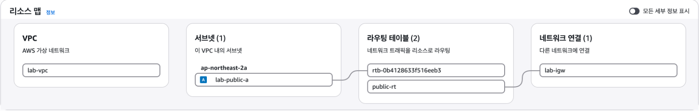
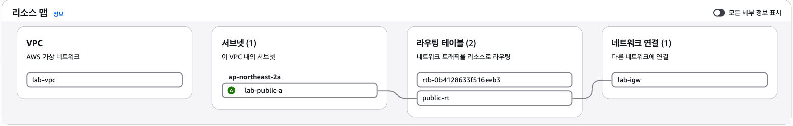
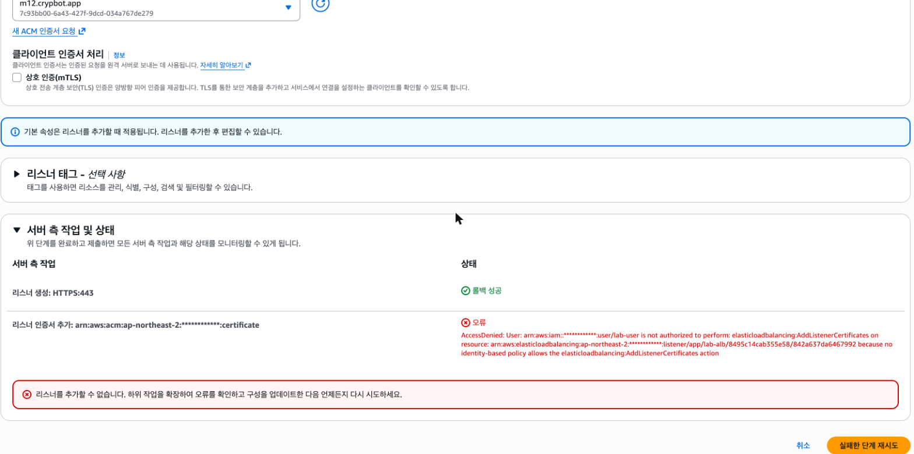
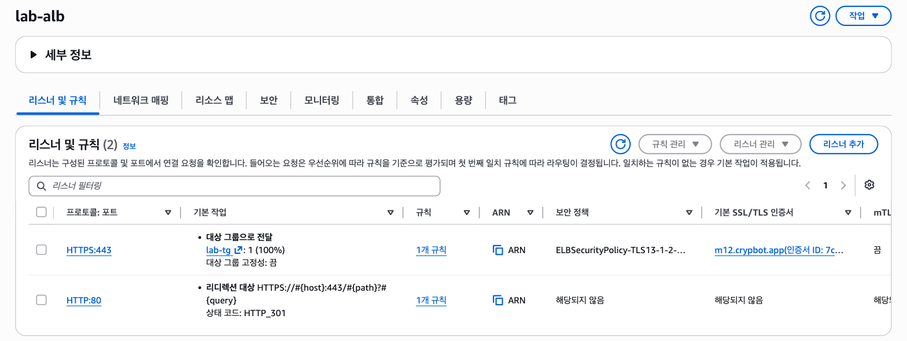

# 트러블슈팅 보고서

실습 중 겪은 장애 2건을 **증상 → 가설 → 검증 → 조치 → 결과 → 재발방지** 순서로 정리했다.

| # | 장애 | 계층 | 성격 | 시각 (2026-10-15 KST) |
|---|---|---|---|---|
| [T1](#t1--공인-ip-로-접속하면-타임아웃) | 공인 IP 로 접속하면 80·22 둘 다 타임아웃 | 네트워크 (라우팅) | 의도적 재현 | 16:09 ~ 16:47 |
| [T-ALB](#t-alb--https-리스너-추가가-accessdenied-후-롤백) | HTTPS 리스너 추가가 AccessDenied 후 롤백 | 권한 (IAM 최소권한) | 실제 발생 | 19:5x ~ 20:14 |

- 발췌한 로그는 실행한 명령과 출력을 그대로 옮겼다. 가린 값은 계정 ID(`************`)와 내 공인 IP(`x.x.x.x`) 두 가지뿐이다.
  원본 로그는 레포에 올리지 않았다.
- 캡처는 [`screenshots/`](../screenshots/)에 있다. 구성 전체는 [`architecture.png`](architecture.png)(1단계)와 [`architecture-extended.png`](architecture-extended.png)(2단계)에 그렸다.

---

## T1 — 공인 IP 로 접속하면 타임아웃

**환경**: `lab-vpc` 10.0.0.0/16 · `lab-public-a` 10.0.1.0/24 · `lab-igw` · `public-sg`(80 ← 0.0.0.0/0, 22 ← 내 IP/32) ·
EC2 `lab-public` `i-092b6a3c00bbee442`(공인 52.79.161.105 / 사설 10.0.1.100, 16:08:50 기동, User data 로 nginx 설치)

**의도적 재현**: 라우팅이 빠졌을 때 어떤 증상이 나는지 보려고, 라우트 테이블 `public-rt`(0.0.0.0/0 → lab-igw)는 만들되
**서브넷 연결만 빼고** EC2 를 띄웠다. 원인을 알고 시작했지만, 진단은 증상에서 출발해 계층마다 하나씩 배제하는 순서로 진행했다.
아래는 그 기록이다.



*▲ 고장 상태 — `lab-public-a` 는 기본 라우트 테이블(`rtb-0b41…`)에 이어져 있다. IGW 로 가는 `public-rt` 와는 이어지지 않았다.*

### 증상

기동 41초 뒤와 211초 뒤에 내 PC 에서 두 번 시도했다. 결과는 같았다.

```
== t1 · step0 symptom (retry) · 2026-10-15 16:12:20 KST (launch +211s) ==
$ curl -sS -v --max-time 10 http://52.79.161.105/health
*   Trying 52.79.161.105:80...
* Connection timed out after 10006 milliseconds
* Closing connection
curl: (28) Connection timed out after 10006 milliseconds
[exit=28]
$ nc -vz -G 5 52.79.161.105 80
nc: connectx to 52.79.161.105 port 80 (tcp) failed: Operation timed out
[exit=1]
$ nc -vz -G 5 52.79.161.105 22
nc: connectx to 52.79.161.105 port 22 (tcp) failed: Operation timed out
[exit=1]
```

- 거절(refused)이 아니라 **타임아웃**이다. 패킷이 중간에 버려지거나 응답이 돌아오지 못한다는 뜻이다.
  호스트까지 닿았는데 포트가 닫혀 있었다면 즉시 refused 가 왔을 것이다.
- **80 과 22 가 동시에** 막혔다. 포트 하나의 규칙 문제보다는 경로 전체의 문제일 가능성이 크다.

### 가설

경로를 바깥에서 안쪽 순서로 따라가며, 막힐 수 있는 곳마다 가설을 세웠다.

| # | 가설 | 맞다면 보일 것 |
|---|---|---|
| H1 | 인스턴스가 아직 부팅 중이거나 비정상이다 | 상태 검사 실패, 시간이 지나면 풀림 |
| H2 | IGW 가 VPC 에 붙어 있지 않다 | IGW attachment 없음 |
| H3 | 보안 그룹이 막는다 | 80·22 인바운드 규칙 없음, 또는 22 출처 ≠ 내 IP |
| H4 | NACL 이 막는다 | deny 규칙이 allow 보다 앞에 있음 |
| H5 | 서브넷의 라우트 테이블에 0.0.0.0/0 → IGW 가 없다 | 서브넷이 IGW 경로 없는 라우트 테이블을 씀 |

### 검증

**H1 기각** (16:14:08) — `running`, System · Instance · EBS 상태 모두 `ok`(콘솔 "3/3 검사 통과"), 공인 IP 52.79.161.105 할당됨. +211초 재시도도 같았으므로 부팅 지연도 아니다.

**H2 기각** (16:16:24) — `igw-057393382633edab5` 가 `lab-vpc` 에 `available` 로 붙어 있다.

**H3 기각** (16:16:24) — 규칙이 의도대로 들어 있다. 22 출처가 지금 내 PC 의 공인 IP 와 같은 것도 확인했다.

```
$ aws ec2 describe-security-groups --filters Name=group-name,Values=public-sg Name=vpc-id,Values=vpc-04b89b36a6e5f95b3
        "Inbound": [
            { "Proto": "tcp", "From": 80, "To": 80, "Cidr": [ "0.0.0.0/0" ], "Desc": [] },
            { "Proto": "tcp", "From": 22, "To": 22, "Cidr": [ "x.x.x.x/32" ], "Desc": [] }
        ],
        "Outbound": [ { "Proto": "-1", "Cidr": [ "0.0.0.0/0" ] } ]
$ curl -s https://checkip.amazonaws.com   # 지금 내 PC 의 공인 IP
x.x.x.x
```

(바깥 괄호와 앞의 `Id`·`Name` 줄은 빼고, 규칙마다 JSON 을 한 줄로 접었다. 값은 원본과 같다.)

**H4 기각** (16:16:25) — 서브넷에 붙은 NACL 은 기본 NACL(`IsDefault: true`)이다. 인바운드·아웃바운드 모두 규칙 100 이 전체 allow 다.

**H5 채택** (16:16:26) — 이 서브넷을 명시적으로 연결한 라우트 테이블이 **없다**. 명시 연결이 없는 서브넷은 VPC 의 기본(main) 라우트 테이블을 쓴다.
그런데 기본 라우트 테이블에는 `local` 경로 하나뿐이다.

```
== t1 · check5 route table · 2026-10-15 16:16:26 KST ==
$ aws ec2 describe-route-tables --filters Name=association.subnet-id,Values=subnet-020964110159af855
{
    "RouteTables": []
}
$ aws ec2 describe-route-tables --filters Name=vpc-id,Values=vpc-04b89b36a6e5f95b3 Name=association.main,Values=true
[
    {
        "Id": "rtb-0b4128633f516eeb3",
        "Associations": [
            {
                "Main": true,
                "SubnetId": null
            }
        ],
        "Routes": [
            {
                "Dest": "10.0.0.0/16",
                "Target": "local",
                "State": "active"
            }
        ]
    }
]
```

VPC 바깥 주소(내 PC)로 가는 경로가 없다. 그래서 요청이 인스턴스까지 닿더라도 **응답이 나갈 길이 없고**, 클라이언트에는 타임아웃으로 보인다.

**보강 근거 — 안에서 밖으로도 막혀 있었다** (16:16:39). 인스턴스 시스템 로그(콘솔 출력)를 보면, 부팅 때 User data 의 `dnf install -y nginx` 가
패키지 저장소에 접속하지 못하고 타임아웃됐다.

```
$ grep -n -E 'dnf install|Curl error \(28\)' t1-7-check6-console-output.txt | head -3
96:[    8.666700] cloud-init[1880]: + dnf install -y nginx
104:[  369.632888] cloud-init[1880]:   - Curl error (28): Timeout was reached for https://al2023-repos-ap-northeast-2-de612dc2.s3.dualstack.ap-northeast-2.amazonaws.com/core/mirrors/2023.12.20261013/x86_64/mirror.list?instance_id=i-092b6a3c00bbee442 [Connection timed out after 30000 milliseconds]
105:[  369.637182] cloud-init[1880]:   - Curl error (28): Timeout was reached for https://al2023-repos-ap-northeast-2-de612dc2.s3.dualstack.ap-northeast-2.amazonaws.com/core/mirrors/2023.12.20261013/x86_64/mirror.list?instance_id=i-092b6a3c00bbee442 [Connection timed out after 30001 milliseconds]
```

보안 그룹 아웃바운드는 전체 허용이므로 보안 그룹으로는 이 실패를 설명할 수 없다. 반면 "밖으로 나가는 경로가 없다"(H5)는 바깥 → 안과 안 → 바깥을 둘 다 설명한다.

### 조치

1. 콘솔에서 `lab-public-a` 를 `public-rt` 에 **명시적으로 연결**했다. 기본 라우트 테이블에는 손대지 않았다(재발방지 2 참고).
2. 같은 원인으로 부팅 때 nginx 설치가 실패해 있었다. User data 는 첫 부팅에 한 번만 실행되므로, 스크립트를 직접 한 번 다시 실행했다.
   `ssh ec2-user@52.79.161.105 'sudo /var/lib/cloud/instance/scripts/part-001'` (16:46)

### 결과

- 16:23:08 — 서브넷이 `public-rt` 에 `associated`, `0.0.0.0/0 → igw-057393382633edab5` 가 `active` 다. 같은 시각 내 PC → 22 포트 연결(`nc`)에 성공했다.
- 16:23:45 — 인스턴스 안에서 `curl -sS -I https://example.com` → `HTTP/2 200`. 아웃바운드가 회복됐다.
- 16:46:40 — 인스턴스 안에서 `curl -i http://localhost/health` → `200 OK`. nginx 는 `active`·`enabled` 다.
- 16:46:52 — 내 PC 에서 `curl -i http://52.79.161.105/health` → **`HTTP/1.1 200 OK` · `OK`** (필수 요건 외부 접속 증빙)



*▲ 수정 후 — `lab-public-a` → `public-rt` → `lab-igw` 로 이어졌다.*

### 재발방지

1. **퍼블릭 서브넷은 "라우트 테이블 명시 연결"까지가 한 작업이다.**
   `describe-route-tables --filters Name=association.subnet-id,Values=<서브넷>` 결과가 `[]` 이면 그 서브넷은 기본 라우트 테이블을 쓰고 있다.
   콘솔 VPC 리소스 맵에서 서브넷 → 라우트 테이블 → IGW 선이 이어지는지도 본다(전·후 캡처).
2. **기본(main) 라우트 테이블에는 IGW 경로를 넣지 않는다.** 그러면 연결을 빠뜨린 서브넷은 인터넷이 막힌 상태로 실패한다(fail closed).
   기본 라우트 테이블을 고쳐서 이번 문제를 해결했다면, 앞으로 만드는 서브넷이 전부 의도치 않게 퍼블릭이 된다.
3. **증상 하나로 계층을 좁힌다.** 타임아웃은 경로·필터(라우팅·SG·NACL)에서 버려졌다는 뜻이고, refused 는 호스트까지 닿았지만 포트가 닫혔다는 뜻이다(앱 계층).
   여러 포트가 동시에 타임아웃이면 경로부터 본다.
4. **배포 확인은 "접속된다"에서 끝내지 않는다.** User data 가 네트워크에 기대는 작업(패키지 설치)을 하다 실패하면 재부팅해도 다시 돌지 않는다.
   `systemctl is-active nginx`, `/var/log/cloud-init-output.log` 로 설치 결과를 따로 확인한다.

캡처: [`t1-1-resource-map-before.png`](../screenshots/t1-1-resource-map-before.png) ·
[`t1-2-check1-instance.png`](../screenshots/t1-2-check1-instance.png) ·
[`t1-3-check2-igw.png`](../screenshots/t1-3-check2-igw.png) ·
[`t1-4-check3-sg.png`](../screenshots/t1-4-check3-sg.png) ·
[`t1-5a`](../screenshots/t1-5a-check4-nacl-inbound.png) / [`t1-5b`](../screenshots/t1-5b-check4-nacl-outbound.png) (NACL) ·
[`t1-6a`](../screenshots/t1-6a-check5-main-rt-routes.png) / [`t1-6b`](../screenshots/t1-6b-check5-main-rt-subnets.png) (기본 라우트 테이블) ·
[`t1-7-check6-system-log.png`](../screenshots/t1-7-check6-system-log.png) ·
[`t1-8-resource-map-after.png`](../screenshots/t1-8-resource-map-after.png) ·
[`phase1-inside-localhost-outbound.png`](../screenshots/phase1-inside-localhost-outbound.png) ·
[`phase1-curl-health.png`](../screenshots/phase1-curl-health.png)

---

## T-ALB — HTTPS 리스너 추가가 AccessDenied 후 롤백

**환경**: IAM 사용자 `lab-user`(고객 관리형 정책 `lab-m12` v4) → 콘솔에서 `lab-alb` 에 리스너 추가.
HTTPS:443, 기본 작업 → `lab-tg`, 보안 정책 `ELBSecurityPolicy-TLS13-1-2-Res-PQ-2025-09`, 인증서 ACM `m12.crypbot.app`(ISSUED).
정책은 실습에 필요한 action 만 하나씩 허용하는 방식이다(관리자 권한 없음, 정책 설명은 [README](../README.md) 참고).

### 증상



*▲ 콘솔 "서버 측 작업 및 상태" — 리스너 생성은 롤백 성공, 리스너 인증서 추가는 `AccessDenied` (계정 ID 가림)*

- 콘솔 "서버 측 작업 및 상태" 패널에 두 줄이 떴다.
  - `리스너 생성: HTTPS:443` → **롤백 성공**
  - `리스너 인증서 추가` → **오류** — `AccessDenied … not authorized to perform: elasticloadbalancing:AddListenerCertificates on resource: …listener/app/lab-alb/…/842a637da6467992 because no identity-based policy allows …`
- 직후 CLI 로 상태를 확인했다. 리스너는 원래 있던 HTTP:80 하나뿐이고, 인증서는 어디에도 쓰이지 않는다(`InUseBy: []`). 반쯤 만들어진 리소스는 남지 않았다.

```
== t-alb · 콘솔 '리스너 추가'(HTTPS:443) 실패 직후 상태 · 2026-10-15 19:53:49 KST ==
# 콘솔 서버 측 작업: '리스너 생성: HTTPS:443' → 롤백 성공 / '리스너 인증서 추가' → AccessDenied elasticloadbalancing:AddListenerCertificates (캡처 t-alb-1-console-denied.png)
$ aws elbv2 describe-listeners --load-balancer-arn arn:aws:elasticloadbalancing:ap-northeast-2:************:loadbalancer/app/lab-alb/8495c14cab355e58 --query 'Listeners[].{Arn:ListenerArn,Port:Port,Protocol:Protocol,Certs:Certificates,Default:DefaultActions[0].Type}' --output json
[
    {
        "Arn": "arn:aws:elasticloadbalancing:ap-northeast-2:************:listener/app/lab-alb/8495c14cab355e58/d3a5d076902260c9",
        "Port": 80,
        "Protocol": "HTTP",
        "Certs": null,
        "Default": "forward"
    }
]
[exit=0]
$ aws acm describe-certificate --certificate-arn arn:aws:acm:ap-northeast-2:************:certificate/7c93bb00-6a43-427f-9dcd-034a767de279 --query 'Certificate.InUseBy' --output json
[]
[exit=0]
```

### 가설

| # | 가설 | 맞다면 보일 것 |
|---|---|---|
| H1 | 콘솔의 일시적 오류다 | 오류 문구가 모호하고, 다시 시도하면 된다 |
| H2 | 정책에 필요한 action 이 빠졌다 | 오류가 거부된 action·resource 를 명시한다 |
| H3 | (H2 의 이유) 콘솔의 "리스너 추가"는 API 를 하나가 아니라 **두 번** 부른다 | 인증서가 리스너에 두 번 등록된다 |

H3 은 정책 설계와 실제가 어긋난 이유를 설명하려고 세웠다. 정책을 설계할 때는 API 문서를 기준으로 봤다.
문서상으로는 `CreateListener` 한 번에 기본 인증서까지 넣어 HTTPS 리스너를 완성할 수 있어서, `CreateListener` 만 허용해 두었다.
그런데 콘솔 폼에는 "이 인증서는 리스너 인증서 목록에 자동으로 추가됩니다"라는 문구가 있었다.

### 검증

- **H1 기각, H2 채택** — 오류 문구가 거부된 action(`elasticloadbalancing:AddListenerCertificates`)과 대상 리스너 ARN 을 정확히 짚는다.
  `because no identity-based policy allows` 는 명시적 거부(Deny)가 아니라 **허용 문장이 없다**(암묵적 거부)는 뜻이다.
  v4 정책의 ELB 문장에는 `CreateListener` 가 있고 `AddListenerCertificates` 는 없다(아래 diff 의 앞뒤 줄).
- **H3** — 콘솔이 ① `CreateListener` 에 성공한 뒤 ② `AddListenerCertificates` 에서 거부되자 ① 을 되돌렸다고 보면 패널의 두 줄이 그대로 설명된다.
  조치 후 결과에서 이를 뒷받침하는 정황도 확인했다(아래 "결과" 둘째 항목).

### 조치

대안이 두 가지 있었다.

- (a) 정책은 그대로 두고 CLI `create-listener` 를 한 번 호출한다. 인증서를 포함해 API 를 한 번만 부르므로 v4 로도 될 것으로 봤다(시도하지는 않았다).
- (b) 정책에 action 하나를 더하고 콘솔에서 다시 시도한다.

**(b) 를 택했다.** 거부된 action **하나만** 추가했고, `elasticloadbalancing:*` 처럼 넓히지 않았다. 정책 저장은 루트 계정으로 했다(lab-user 에는 IAM 수정 권한이 없다).

```
== t-alb · 조치: 정책 lab-m12 v4 → v5 (레포 iam/lab-m12-policy.json 치환본 비교) · 2026-10-15 19:58:51 KST ==
$ diff -u lab-m12-policy.v4.json lab-m12-policy.v5.json
--- lab-m12-policy.v4.json	2026-10-15 19:03:15
+++ lab-m12-policy.v5.json	2026-10-15 19:55:50
@@ -88,6 +88,7 @@
         "elasticloadbalancing:RegisterTargets", "elasticloadbalancing:DeregisterTargets",
         "elasticloadbalancing:CreateListener", "elasticloadbalancing:DeleteListener",
         "elasticloadbalancing:ModifyListener",
+        "elasticloadbalancing:AddListenerCertificates",
         "elasticloadbalancing:AddTags", "elasticloadbalancing:RemoveTags"
       ],
       "Resource": "*",
[exit=1]
```

**반영 확인**: lab-user 는 IAM 정책을 읽을 수 없다. 그래서 **존재하지 않는 리스너 ARN** 에 같은 API 를 호출해, 돌아오는 오류의 종류로 반영 여부를 판별했다.
권한 검사가 리소스 존재 확인보다 먼저 일어난다고 보고, `AccessDenied` 면 미반영, `ListenerNotFound` 면 반영으로 판단했다.
v4 상태에서 같은 호출을 해 보는 대조 실험은 하지 않았다. 호출 뒤 리스너 목록이 그대로인 것(HTTP:80 하나)도 확인했다.

```
== t-alb · v5 반영 확인 (없는 리스너 ARN 으로 권한만 판별 — 사용자 승인) · 2026-10-15 20:08:46 KST ==
# AccessDenied = 권한 없음(v5 미반영) / ListenerNotFound = 권한 통과(v5 반영), 리스너가 없으므로 변경 없음
$ aws sts get-caller-identity --query Arn --output text
arn:aws:iam::************:user/lab-user
[exit=0]
$ aws elbv2 add-listener-certificates --listener-arn arn:aws:elasticloadbalancing:ap-northeast-2:************:listener/app/lab-alb/8495c14cab355e58/0000000000000000 --certificates CertificateArn=arn:aws:acm:ap-northeast-2:************:certificate/7c93bb00-6a43-427f-9dcd-034a767de279

aws: [ERROR]: An error occurred (ListenerNotFound) when calling the AddListenerCertificates operation: Listener 'arn:aws:elasticloadbalancing:ap-northeast-2:************:listener/app/lab-alb/8495c14cab355e58/0000000000000000' not found

Additional error details:
Type: Sender
[exit=254]
$ aws elbv2 describe-listeners --load-balancer-arn arn:aws:elasticloadbalancing:ap-northeast-2:************:loadbalancer/app/lab-alb/8495c14cab355e58 --query 'Listeners[].{Port:Port,Protocol:Protocol,Default:DefaultActions[0].Type}' --output table
---------------------------------
|       DescribeListeners       |
+---------+--------+------------+
| Default | Port   | Protocol   |
+---------+--------+------------+
|  forward|  80    |  HTTP      |
+---------+--------+------------+
[exit=0]
```

### 결과

- 20:10 — 콘솔에서 HTTPS:443(→ `lab-tg`) 리스너를 다시 만들었고 성공했다. 이어서 기존 HTTP:80 은 HTTPS:443 으로 보내는 **301 리다이렉트**로 바꿨다(20:10:29 CLI 확인).
- **H3 의 정황 증거** — 리스너 인증서 목록에 **같은 인증서가 두 번** 있다. 콘솔 패널의 두 줄(리스너 생성 / 리스너 인증서 추가)과 맞춰 보면,
  `IsDefault: true` 는 `CreateListener` 가, `IsDefault: false` 는 `AddListenerCertificates` 가 넣은 것으로 보인다. API 호출 기록(CloudTrail)은 보지 않았다.

  ```
  $ aws elbv2 describe-listener-certificates --listener-arn arn:aws:elasticloadbalancing:ap-northeast-2:************:listener/app/lab-alb/8495c14cab355e58/b409159dc1e38e6e --output json
  {
      "Certificates": [
          {
              "CertificateArn": "arn:aws:acm:ap-northeast-2:************:certificate/7c93bb00-6a43-427f-9dcd-034a767de279",
              "IsDefault": false
          },
          {
              "CertificateArn": "arn:aws:acm:ap-northeast-2:************:certificate/7c93bb00-6a43-427f-9dcd-034a767de279",
              "IsDefault": true
          }
      ]
  }
  ```
- ACM 인증서 `InUseBy` = `lab-alb`, 갱신 자격 `INELIGIBLE` → `ELIGIBLE`(사용 중인 인증서만 자동 갱신 대상이다).
- 20:14 — Route 53 별칭 레코드까지 연결한 뒤 `https://m12.crypbot.app/health` → `HTTP/2 200`(TLSv1.3, `CN=m12.crypbot.app`), `http://` → `301`.



*▲ 다시 만든 뒤의 리스너 — HTTPS:443 → `lab-tg`, HTTP:80 → HTTPS 301.*

### 재발방지

1. **콘솔용 최소 권한은 API 문서만 보고 정하지 않는다.** 콘솔 작업 하나가 API 여러 개로 이뤄질 수 있다.
   한 번 실행해 보고, "서버 측 작업" 패널이나 거부 메시지로 실제 호출을 확인한 뒤 그 action 만 더한다.
2. **권한 반영은 "없는 리소스에 호출"로 확인한다.** `AccessDenied` 와 `NotFound` 를 가르면 정책을 읽을 권한 없이도, 리소스를 바꾸지 않고 판별할 수 있다.
3. **실제 작업이 실패할 때만 권한을 더한다.** 콘솔 화면 곳곳에 뜨는 표시용 거부 배너는 작업을 막지 않으므로 정책에 넣지 않았다.
   예: Route 53 대시보드의 `route53domains:*`([캡처](../screenshots/phase3-5-route53-dashboard-denied.png)), SSM 연결 화면의 `ssm:GetServiceSetting`([캡처](../screenshots/phase2-6-ssm-connect-precheck-denied.png)).
4. **다단계 콘솔 작업이 실패하면 롤백이 깨끗했는지 CLI 로 확인한다.** 이번에는 리스너 1개, 인증서 미사용으로 원상 그대로였다.
5. 정책 버전은 최대 5개이고 이번 수정으로 v1~v5 를 다 채웠다. 다음에 고칠 때는 옛 버전 하나를 먼저 지워야 한다.

캡처: [`t-alb-1-console-denied.png`](../screenshots/t-alb-1-console-denied.png) ·
[`t-alb-2-policy-v5-diff.png`](../screenshots/t-alb-2-policy-v5-diff.png) ·
[`t-alb-3-permission-probe.png`](../screenshots/t-alb-3-permission-probe.png) ·
[`phase3-6-listeners.png`](../screenshots/phase3-6-listeners.png) ·
[`phase3-6-http80-redirect.png`](../screenshots/phase3-6-http80-redirect.png) ·
[`phase3-7-https-curl.png`](../screenshots/phase3-7-https-curl.png)
